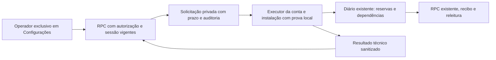

# Suporte remoto em Configurações — desenho e ativação

O módulo foi desenvolvido em branch isolada e recebeu autorização específica de publicação e ativação em 12/11/2026. A migration `20261112202826_suporte_remoto_exclusivo.sql` corresponde à versão registrada pelo serviço em produção; seu SQL começa desativado e com operador nulo. Vínculo, flag do cliente e ativação são operações separadas e verificadas. A autorização anterior das melhorias de sincronização, por si só, não autorizava esse canal.

## Escopo e navegação

O único ponto de entrada é **Configurações → Suporte remoto**. A capacidade vem do servidor e é vinculada à sessão autenticada; nome, e-mail, cargo e dados locais não autorizam acesso. Uma rota solicitada sem capacidade mostra acesso negado. Os demais menus de Configurações permanecem com suas permissões existentes. O executor fica montado uma vez no aplicativo autenticado, independentemente de o painel estar aberto, fora de DEMO.

## Identidade e autorização

A identidade pretendida foi localizada de forma única em perfil ativo associado a conta de autenticação com e-mail confirmado. A evidência e o UUID permanecem no relatório privado, sem dados pessoais no código. A migration não presume que uma conta administradora seja o operador.

`integracao_suporte_privado.config.operador` aceita um único UUID. Só administração SQL do projeto pode vincular/revogar esse operador após a revisão; não existe ação de aplicação que conceda o acesso. Cada RPC exige perfil ativo e `session_id` existente em `auth.sessions`, pertencente ao usuário e dentro da validade. Uma sessão revogada não pode operar o canal. Cargos de administrador ou diretor não substituem a identidade configurada.

A RPC pública é `SECURITY INVOKER`; a função privilegiada fica no schema privado, com `search_path` vazio e verificações explícitas. As novas tabelas têm RLS e nenhum acesso direto para clientes. `PUBLIC`, `anon` e `service_role` não executam o novo canal. Nenhuma política ou grant de tabelas de negócio é alterada.

## Vínculo da instalação

UUID identifica a instalação, mas não autentica seu navegador. O executor cria atomicamente em IndexedDB próprio um novo UUID de suporte e uma prova aleatória de 256 bits por conta. Duas abas compartilham esse vínculo; outro navegador possui outro. O servidor guarda somente SHA256 da prova. Cada chamada do executor exige JWT válido, conta, instalação e prova correspondentes.

A prova não vai para localStorage, painel, auditoria, cópias de recuperação, mensagens ou URLs. É enviada apenas no corpo POST por HTTPS ao Supabase já configurado. Falha de IndexedDB/quota interrompe o suporte; não há fallback volátil. Perder o armazenamento gera outra instalação; a anterior não é reassociada automaticamente.

O vínculo com o UUID do diagnóstico antigo é uma associação declarada pelo próprio aplicativo, não uma atestação física. Não somar relatos associados como se fossem computadores físicos distintos. O painel diferencia contato do executor, versão compatível, horário do relato e ausência de relato. Sem relato não significa zero pendências.

## Ações fechadas

| Ação | Efeito permitido |
| --- | --- |
| Diagnóstico | Até 100 pedidos técnicos por resposta; pedido específico permite inspeção pontual |
| Consultar recibo | Consulta o mesmo pedido/payload preservado; não prepara nem envia gravação |
| Repetir leitura | Exige recibo local e usa confirmação existente; não reenvia dados |
| Retomar automáticas | Reutiliza o processador existente, limites, reservas e dependências; não libera recusas de validação/conflito/permissão |
| Solicitar atualização | Apresenta aviso e botão ao funcionário; nunca recarrega por comando remoto |
| Revisar bloqueios | Retorna diagnóstico técnico para decisão humana, sem escolher valores |

Pedidos incertos mantêm identidade e payload. Confirmados fazem releitura. Campos de cadastro, reconhecimento de divergências, descarte, reset, sobrescrita, SQL livre, código arbitrário, impersonação e ampliação de permissões ficam fora do canal. A seleção de gravações não é duplicada: o diário existente continua sendo o executor das intenções.

## Dados e comprovação

O resultado admite somente UUIDs técnicos, estado, fase, código permitido, tentativas, presença de recibo, dependências, restrição conhecida e motivo de espera. Chaves extras, textos livres, erros completos, valores, autores, payloads, nomes de clientes, documentos, renda, caminhos ou bytes de arquivos são rejeitados no servidor. O cliente também usa lista positiva e elimina causas brutas dos erros.

Para um pedido individual, o servidor verifica a existência do recibo na mesma conta e sinaliza essa presença separadamente. O conteúdo relido continua identificado como relato do aparelho. Não há comprovação automática de propagação para outra instalação. Solicitação concluída não significa que todas as pendências do usuário foram resolvidas.

## Prazo, concorrência e auditoria

Parâmetros propostos, configuráveis para revisão: validade de 300 segundos, intervalo mínimo de 60 segundos por aparelho, reserva de 60 segundos, contato recente de até 120 segundos e no máximo três entregas antes do início. A retenção proposta é 90 dias; esta entrega **não apaga auditoria automaticamente**.

O operador fornece um UUID de solicitação e de atendimento. Nonce e conteúdo idênticos devolvem a mesma solicitação; conteúdo diferente com o mesmo nonce é recusado. Há somente uma solicitação ativa por conta/instalação. Reserva e autorização usam transações e bloqueios; somente uma aba recebe/autorizada executa.

Autorizar é uma transição única. Antes de preparar, consultar, enviar ou reler, o executor revalida o comando no servidor. Expiração, revogação e cancelamento impedem efeitos seguintes. Uma ação já em andamento pode ter produzido efeito antes do cancelamento; nesse caso o estado permanece incerto. Perder a resposta de autorização ou conclusão nunca dispara uma nova execução. Resultado tardio é auditado sem converter cancelamento/incerteza em sucesso.

Auditoria somente de acréscimo registra solicitação, ator, evento, horário e motivo técnico permitido. Clientes não editam/apagam o histórico. A administração do banco permanece uma fronteira privilegiada de confiança, como no restante do sistema.

## Indicação visível ao funcionário

O aplicativo habilitado mostra uma indicação não modal de que solicitações de Jonathan podem ser recebidas, com ações registradas e sem acesso à tela. Tentativas seguras não exigem confirmação repetida do funcionário. O painel de operação continua exclusivo do proprietário. A solicitação de atualização permanece uma decisão local explícita.

## Atualização e preservação local

A atualização exige clique do funcionário, sessão original, ausência de envio e de pendências, nenhum arquivo pendente e nenhuma edição detectada. A guarda é conservadora: campos editáveis visíveis impedem recarga mesmo sem foco, além dos marcadores e diálogos existentes. A pessoa deve terminar a edição e abrir uma tela sem campos editáveis.

Antes de permitir recarga, uma cópia local identificada por conta/UUID é gravada e relida integralmente. Edição, troca de conta, quota ou divergência durante a gravação abortam a atualização. Cópias anteriores não são sobrescritas e não são restauradas automaticamente. O reagendamento normal de sincronização é preservado quando um diagnóstico ou uma tentativa de atualização termina.

Sem aplicativo atualizado/ativo, sessão válida e internet, não há execução garantida. Abas suspensas podem atrasar solicitações; as vencidas não executam ao retornar. Um novo navegador não acessa o IndexedDB do anterior. O módulo não alcança a tela, terminal ou outros arquivos do computador.

## Validação e reversão

Os testes usam contas, aparelhos e dados fictícios. Incluem SQL com RLS/ACL, administrador/diretor recusados, prova incorreta em outra sessão da mesma conta, relogin legítimo, duas abas, replay, expiração, revogação, cancelamento, ACK perdido, saneamento de resultados, quota, recuperação local e interface desktop/celular.

`scripts/verificar-suporte-postgres.mjs` é um teste adicional explícito com PostgreSQL local. Ele cria cluster próprio, confirma seu diretório, usa duas conexões reais, testa reserva/autorização concorrentes, faz backup dos objetos novos, restaura em outro banco descartável e testa desativação preservando comandos, auditoria e recibos. Não se conecta ao Supabase nem a cluster existente. Exemplo: `SUPORTE_PG_BIN=/caminho/postgresql/bin node scripts/verificar-suporte-postgres.mjs`.

Esse backup é de fixtures e objetos novos, não de produção. A migration foi aplicada inicialmente desativada após confirmação de backup físico disponível no projeto. Esse backup de produção não foi restaurado durante o rollout; não presumir que os testes locais comprovem uma restauração integral de produção.

A reversão preparada em `supabase/operacoes/suporte-remoto-desativar.sql` desativa o canal, cancela apenas solicitações não iniciadas, marca iniciadas como incertas e revoga sua execução. Não remove tabelas, auditoria, recibos ou armazenamento local. Desabilitar a flag e voltar o deployment do cliente complementam a reversão. Não fazer `DROP`, limpeza de IndexedDB ou exclusão de filas.

## Condições antes da ativação

1. Revisar este desenho, os parâmetros e as ações com o proprietário.
2. Aprovar especificamente migration, vínculo do UUID verificado do operador, flag do cliente e ativação; são operações distintas de preparar o PR.
3. Confirmar backup de produção e reversão do deployment aprovado.
4. Revisar configuração real de logs, traces e proxies para que corpos/parâmetros com prova de instalação não sejam capturados. A sanitização da aplicação não controla logs externos.
5. Aplicar primeiro a migration desativada, conferir ACL/RLS/advisors e só depois vincular o operador e autorizar o rollout controlado.
6. Validar com duas contas e dois navegadores autorizados de teste, incluindo a leitura da segunda conta. Sessões reais e pendências existentes exigem evidência própria; fixtures não comprovam sua resolução.

Não habilitar o módulo enquanto essas condições não forem revisadas e autorizadas. A entrega não restaura, recria ou modifica registros de funcionários para demonstrar funcionamento.
